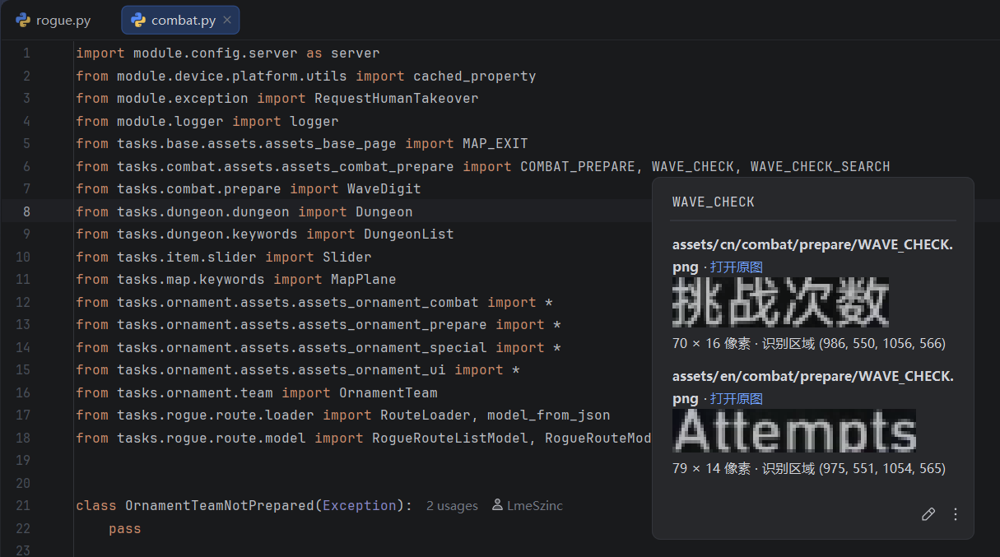
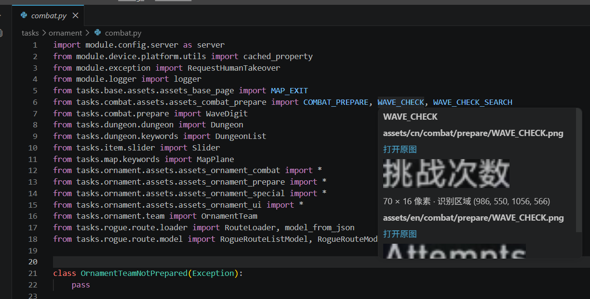

# ALAS Asset Preview

在代码里看素材，点一下就能打开原图。

## 截图

PyCharm：



VS Code：



## 用法

到[发布页](https://github.com/Rea1-ms/ALAS-Asset-Preview-Plugin/releases)下载对应安装包，也可以自行构建。

- PyCharm 2026.3：在“设置 → 插件 → 齿轮 → 从磁盘安装插件”中选择压缩包，安装后重启。开启“悬停时显示快速文档”，然后把鼠标放到素材变量上；也可以按 Ctrl+Q。
- VS Code 1.96及以上：在扩展面板菜单中选择“从 VSIX 安装”，安装后按提示重新加载窗口，再把鼠标放到素材变量上。

点击预览图或“打开原图”，就能在编辑器里打开对应图片。

## 构建

需要 Node.js 和 pnpm。构建开发工具插件还需要本机安装 2026.3 版本的编辑器。

在 PowerShell 中进入仓库目录，运行：

```powershell
pnpm install --ignore-scripts --store-dir .cache/pnpm-store
$env:ALAS_PREVIEW_IDE_HOME = '你的编辑器安装目录'
pnpm build
```

生成的安装包放在 dist ，构建和测试缓存放在 .cache。

运行 pnpm test 可以检查两个插件；首次测试会下载独立的编辑器到缓存目录。也可以直接使用 .idea/runConfigurations 里的8个配置，分别构建、测试和打包。

## 文档

- [PyCharm 插件说明](pycharm/README.md)
- [VS Code  扩展说明](vscode/README.md)
- [验证记录](VALIDATION.md)

## 致谢

感谢 [ALAS（自动化框架）](https://github.com/LmeSzinc/AzurLaneAutoScript) 及其衍生项目提供的素材组织方式。截图使用 [SRC（崩铁自动化项目）](https://github.com/LmeSzinc/StarRailCopilot) 演示。

代码编辑器版本使用了 Lezer（语法解析库）和 pngjs（图片处理库），感谢这些项目的维护者。

## 许可证

目前尚未指定开源许可证。第三方依赖的许可见[第三方许可说明](vscode/THIRD_PARTY_NOTICES.md)。
